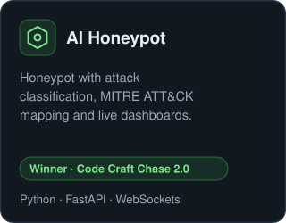
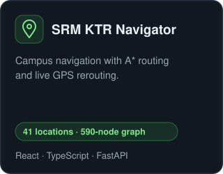

  
  

### Featured Projects

  
  
  

### Contribution Activity

### Tech Stack

  

### Experience

**AI/ML Intern, Coirei** · Feb 2026 – Jun 2026 
Fine-tuned an LLM for vulnerability analysis, shipped an AI sales follow-up agent on Llama 3, and built a Gmail MCP server.

  <a href="https://linkedin.com/in/madhur-grover-4194a837b">LinkedIn</a> ·
  <a href="mailto:madhurgrover835@gmail.com">Email</a> ·
  <a href="https://leetcode.com/u/Madhurr3829">LeetCode</a>

